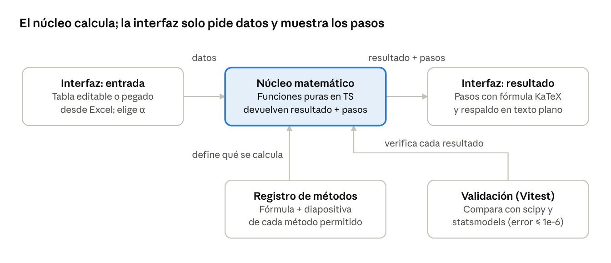

# Propuesta — Programa de resolución estadística (Taller tercer corte)

Nov 3, 2026 · @Alejandro Cárdenas

## Resumen y objetivo

Se propone una aplicación web que resuelve, paso a paso y con los
métodos vistos en clase, cualquier problema del tipo del taller del
tercer corte de Estadística (prof. Mario Muñoz Ochoa, Universidad del
Cauca): regresión lineal simple y múltiple, y probabilidad y técnicas de
conteo.

**Problema que resuelve.** Resolver estos ejercicios a mano exige muchas
operaciones repetitivas (tablas de productos, sumas, matrices, tablas F
y Z) en las que un error de cálculo invalida todo el procedimiento. Las
herramientas existentes (Excel, calculadoras, librerías) entregan el
resultado pero no el procedimiento, o usan métodos distintos a los del
curso.

**Objetivo general.** Desarrollar un programa que, a partir de los datos
de un problema, muestre la resolución completa con las fórmulas y la
notación de las diapositivas del curso, citando la diapositiva de donde
proviene cada paso, y cuyos resultados estén validados contra software
estadístico de referencia.

**Objetivos específicos.**

1.  Implementar los métodos de cada tema exactamente como se presentan
    en las diapositivas del curso.

2.  Mostrar cada paso con su fórmula, la sustitución de valores y el
    resultado.

3.  Aceptar cualquier conjunto de datos de entrada (cualquier n, número
    de variables y nivel de significancia).

4.  Validar los resultados contra scipy y statsmodels (Python) con una
    tolerancia de 10⁻⁶.

5.  Publicar el programa como una página web que el docente abre desde
    un enlace, sin instalar nada.

**Usuarios.** El docente, para revisar y demostrar ejercicios, y los
estudiantes, para verificar su propio procedimiento.

## Alcance

El programa tiene dos módulos, uno por tema del taller con material de
clase disponible. Cada uno cubre los tipos de problema que aparecen en
los talleres del corte.

| Módulo                | Tipos de problema                                                                                                                                                                                                       | Ejemplos del taller                   |
|-----------------------|-------------------------------------------------------------------------------------------------------------------------------------------------------------------------------------------------------------------------|---------------------------------------|
| Regresión lineal      | Simple y múltiple (k variables): estimación de parámetros, tabla ANOVA, prueba F, R², predicción; covarianza y correlación de Pearson                                                                                   | Taller de regresión, puntos 1 a 4     |
| Probabilidad y conteo | Regla de la multiplicación, permutaciones (simples, circulares, con repetición), combinaciones, espacio muestral, regla aditiva, complemento, condicional, independencia, regla del producto, probabilidad total, Bayes | Taller de probabilidad, puntos 1 a 36 |

**Fuera del alcance:** las distribuciones discretas (hipergeométrica,
binomial, Poisson) y la distribución normal, que quedan para una segunda
versión una vez se confirme el material de referencia con el docente;
los temas no vistos en el corte (intervalos de confianza para
predicción, regresión no lineal); y la gestión de usuarios o
almacenamiento en servidor.

## Requerimientos

### Funcionales

| ID    | Requerimiento                                                                                                                                                                                                    |
|-------|------------------------------------------------------------------------------------------------------------------------------------------------------------------------------------------------------------------|
| RF-01 | El usuario ingresa datos en una tabla editable o pegándolos desde Excel; el programa acepta cualquier número de filas y de variables x.                                                                          |
| RF-02 | Regresión: calcula la tabla de productos con sus sumas, plantea las ecuaciones normales, construye X'X y X'y y obtiene β̂ = (X'X)⁻¹X'y.                                                                           |
| RF-03 | Regresión: construye la tabla ANOVA con SCR = Σ(Ŷ − Ȳ)², SCE = Σ(Y − Ŷ)², SCT = Σ(Y − Ȳ)², grados de libertad, cuadrados medios y F.                                                                             |
| RF-04 | Regresión: realiza la prueba de hipótesis H₀: β₁ = … = βₖ = 0 con el α que elija el usuario, compara F con el valor de tabla y redacta la decisión.                                                              |
| RF-05 | Regresión: calcula R², interpreta el porcentaje explicado y predice ŷ para valores dados de las x.                                                                                                               |
| RF-06 | Regresión: calcula las varianzas de los estimadores, σ²(β̂ᵢ) = cᵢᵢS², a partir de (X'X)⁻¹.                                                                                                                        |
| RF-07 | Probabilidad: resuelve conteos (multiplicación, nPr, circulares, con repetición, nCr) y probabilidades (unión, complemento, condicional, producto, total, Bayes), incluida la entrada de tablas de contingencia. |
| RF-10 | Cada resultado se acompaña del procedimiento: fórmula, sustitución de valores, resultado y diapositiva de referencia.                                                                                            |
| RF-11 | Cada módulo incluye los ejercicios del taller precargados como ejemplos.                                                                                                                                         |
| RF-12 | Se incluyen gráficas de apoyo: dispersión con recta ajustada.                                                                                                                                                    |

### No funcionales

| ID     | Requerimiento                                                                                                                                               |
|--------|-------------------------------------------------------------------------------------------------------------------------------------------------------------|
| RNF-01 | **Fidelidad al curso:** solo se muestran métodos del registro de métodos (sección siguiente); ningún paso usa una técnica no vista en clase.                |
| RNF-02 | **Exactitud:** los resultados coinciden con scipy/statsmodels con un error menor a 10⁻⁶.                                                                    |
| RNF-03 | **Robustez del renderizado:** toda fórmula tiene una versión en texto plano; si el LaTeX falla, se muestra el texto en lugar de un error.                   |
| RNF-04 | **Acceso:** la aplicación funciona desde un enlace en cualquier navegador moderno, sin instalación ni servidor.                                             |
| RNF-05 | **Usabilidad:** un ejercicio del taller se resuelve en menos de un minuto desde que se abre la página.                                                      |
| RNF-06 | **Validación de entradas:** el programa avisa de datos inválidos (columnas vacías, sistemas sin solución, probabilidades fuera de \[0, 1\]) sin bloquearse. |

## Registro de métodos

Cada cálculo que muestra el programa corresponde a una fila de este
registro y cita su diapositiva. Un método que no esté aquí no se usa.

### Regresión simple — presentación «Covarianza y regresión lineal»

| Método                       | Fórmula                                               | Diap. |
|------------------------------|-------------------------------------------------------|-------|
| Covarianza                   | Cov(x,y) = Σ(xᵢ − x̄)(yᵢ − ȳ)/n = Σxᵢyᵢ/n − x̄ȳ         | 10    |
| Correlación de Pearson       | r = Cov(x,y)/(SₓSᵧ), con su interpretación por rangos | 12–13 |
| Ecuaciones normales          | nβ̂₀ + β̂₁Σx = Σy; β̂₀Σx + β̂₁Σx² = Σxy                   | 23    |
| Estimadores                  | β̂₁ = (nΣxy − ΣxΣy)/(nΣx² − (Σx)²); β̂₀ = ȳ − β̂₁x̄       | 23    |
| Tabla ANOVA                  | SCR, SCE, SCT; gl 1, n − 2, n − 1; F = CMR/CME        | 24–25 |
| Coeficiente de determinación | R² = 1 − SCE/SCT = SCR/SCT                            | 26    |

### Regresión múltiple — presentación «Regresión lineal múltiple»

| Método                      | Fórmula                                                                                              | Diap. |
|-----------------------------|------------------------------------------------------------------------------------------------------|-------|
| Ecuaciones normales         | Sistema de k + 1 ecuaciones con Σx, Σx², Σxⱼxₗ, Σxⱼy                                                 | 5     |
| Forma matricial             | y = Xβ + ε; A = X'X, g = X'y; β̂ = (X'X)⁻¹X'y                                                         | 7–8   |
| Varianza de los estimadores | σ²(β̂ᵢ) = cᵢᵢσ², estimada con S² = SCE/(n − k − 1)                                                    | 9–10  |
| Tabla ANOVA                 | SCR = Σ(Ŷ − Ȳ)², SCE = Σ(Y − Ŷ)², SCT = Σ(Y − Ȳ)²; gl k, n − (k + 1), n − 1; prueba de cola superior | 11–12 |

### Probabilidad — presentación «Principios de probabilidad»

| Método                                 | Fórmula                                                          | Diap. |
|----------------------------------------|------------------------------------------------------------------|-------|
| Espacio muestral, eventos, complemento | S, A, A′; diagramas de árbol y de Venn                           | 4–11  |
| Unión e intersección                   | A ∪ B, A ∩ B; eventos mutuamente excluyentes                     | 12–13 |
| Regla de la multiplicación             | n₁·n₂·…·nₖ                                                       | 14–16 |
| Permutaciones                          | n!; nPr = n!/(n − r)!; circulares (n − 1)!                       | 16–18 |
| Permutaciones con repetición           | n!/(n₁!·n₂!·…·nₖ!)                                               | 19    |
| Combinaciones                          | nCr = n!/((n − r)!·r!)                                           | 20–21 |
| Axiomas                                | 0 ≤ P(A) ≤ 1; P(A) como suma de pesos de puntos muestrales       | 22–25 |
| Regla aditiva                          | P(A ∪ B) = P(A) + P(B) − P(A ∩ B), y su versión con tres eventos | 26–28 |
| Complemento                            | P(A) = 1 − P(A′)                                                 | 29    |
| Probabilidad condicional               | P(B\|A) = P(A ∩ B)/P(A); tablas de contingencia                  | 30–32 |
| Independencia                          | P(A ∩ B) = P(A)P(B)                                              | 33    |
| Regla del producto                     | P(A ∩ B) = P(A)P(B\|A)                                           | 34    |
| Probabilidad total                     | P(A) = Σ P(Bᵢ)P(A\|Bᵢ)                                           | 35–36 |
| Teorema de Bayes                       | P(Bᵣ\|A) = P(Bᵣ)P(A\|Bᵣ) / Σ P(Bᵢ)P(A\|Bᵢ)                       | 37    |

## Arquitectura

arquitectura · núcleo, registro, validación e interfaz

La interfaz no hace cálculos: envía los datos al núcleo y muestra lo que
este devuelve. El núcleo solo puede usar métodos del registro, y cada
resultado pasa por las pruebas de validación antes de publicarse.

## Tecnología, estructura y despliegue

| Necesidad                                                 | Herramienta                                                                                    |
|-----------------------------------------------------------|------------------------------------------------------------------------------------------------|
| Base del proyecto                                         | Vite + React + TypeScript                                                                      |
| Distribución F (valor de tabla de la prueba de hipótesis) | jStat, usado solo para los valores que en clase se buscan en tabla                             |
| Matrices (X'X, inversa)                                   | Implementación propia por Gauss-Jordan, para poder mostrar los pasos; mathjs como verificación |
| Fórmulas                                                  | KaTeX, con texto plano de respaldo                                                             |
| Gráficas                                                  | Recharts                                                                                       |
| Pruebas                                                   | Vitest                                                                                         |
| Valores de referencia                                     | Python con scipy y statsmodels (solo en desarrollo, no se despliega)                           |
| Despliegue                                                | Vercel conectado al repositorio de GitHub (GitHub Pages como alternativa)                      |

estadistica-app/  
├── src/  
│ ├── core/ \# Matemática pura, sin React  
│ │ ├── steps.ts \# Tipos Paso y Solucion; registro de métodos  
│ │ ├── latex.ts \# Constructores de fórmulas (frac, sum, num)  
│ │ ├── linalg/ \# Transpuesta, producto, inversa por Gauss-Jordan  
│ │ ├── regresion/ \# Ajuste, ANOVA, prueba F, R², predicción  
│ │ ├── combinatoria/ \# Multiplicación, nPr, circulares, repetición,
nCr  
│ │ ├── probabilidad/ \# Aditiva, complemento, condicional, total,
Bayes  
│ │ └── distribuciones/ \# Distribución F  
│ ├── modules/ \# Una sección de la interfaz por tema  
│ ├── components/ \# StepView, Formula, DataGrid, gráficas  
│ └── App.tsx  
├── tests/ \# Comparan core/ contra los fixtures  
├── validation/ \# Scripts de Python y fixtures JSON  
└── README.md

Cada función del núcleo devuelve el resultado y la lista de pasos que lo
producen; cada paso guarda título, fórmula en LaTeX, versión en texto
plano, sustitución, resultado y referencia a la diapositiva. Vercel
publica automáticamente cada cambio en la rama principal y genera un
enlace de prueba por cada rama, de modo que el enlace del docente solo
cambia con versiones revisadas.

## Validación y criterios de aceptación

La exactitud se demuestra con pruebas automáticas. Un script de Python
calcula cada caso con scipy y statsmodels y guarda entradas y resultados
esperados en archivos JSON; las pruebas de Vitest exigen que el núcleo
los reproduzca con un error menor a 10⁻⁶. Una segunda prueba renderiza
cada fórmula generada con KaTeX en modo estricto, de modo que ningún
error de LaTeX llega al despliegue.

| Criterio                                                 | Cómo se verifica                                                                                                                  |
|----------------------------------------------------------|-----------------------------------------------------------------------------------------------------------------------------------|
| Reproduce todos los ejercicios de los talleres del corte | Cada ejercicio es un caso de prueba con sus resultados de referencia                                                              |
| Coincide con software de referencia                      | Error menor a 10⁻⁶ frente a scipy y statsmodels                                                                                   |
| Coincide con el material del curso                       | Los ejemplos resueltos en las diapositivas (por ejemplo, el ejercicio de los camiones diésel) dan los mismos valores que en clase |
| Solo usa métodos del curso                               | Cada paso mostrado tiene una referencia válida en el registro de métodos                                                          |
| Ninguna fórmula falla al mostrarse                       | Prueba de renderizado de todas las fórmulas                                                                                       |

## Plan de trabajo y pendientes

El desarrollo se organiza en fases cortas; cada una termina con una
versión publicada que se puede revisar.

1.  **Núcleo y regresión:** motor de pasos, constructores de LaTeX,
    álgebra matricial y módulo de regresión simple y múltiple, validado
    con los cuatro puntos del taller y el ejemplo de los camiones
    diésel.

2.  **Probabilidad y conteo:** módulo completo, validado con los 36
    puntos del taller de probabilidad.

3.  **Interfaz y despliegue:** pulido de la interfaz, ejemplos
    precargados, gráficas y publicación en Vercel.

**Pendientes para el docente:**

- [ ] Confirmar si se incluirán las distribuciones discretas y la
  distribución normal en una segunda versión y, de ser así, cuál es el
  material de referencia, que no está en las presentaciones disponibles.

- [ ] Confirmar si se espera la prueba de significancia individual de
  cada coeficiente (estadístico t), como aparece en el ejemplo de
  regresión múltiple en Excel.

- [ ] Confirmar la fecha de entrega del programa.
